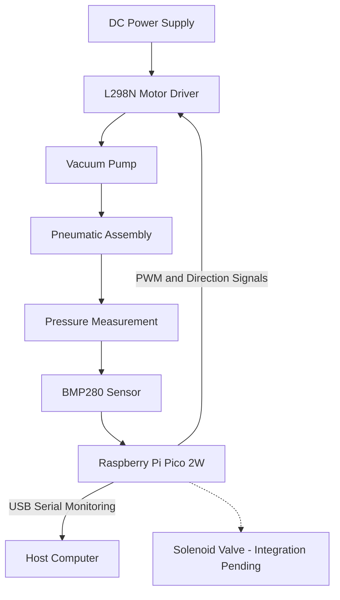
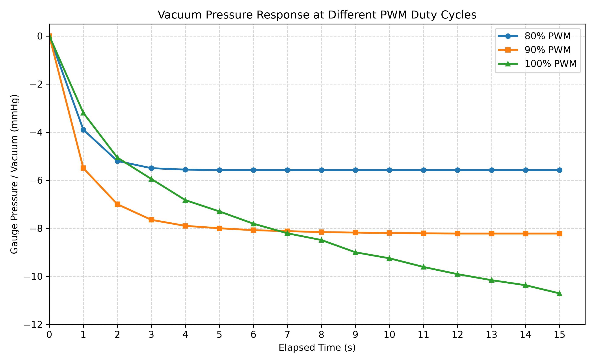
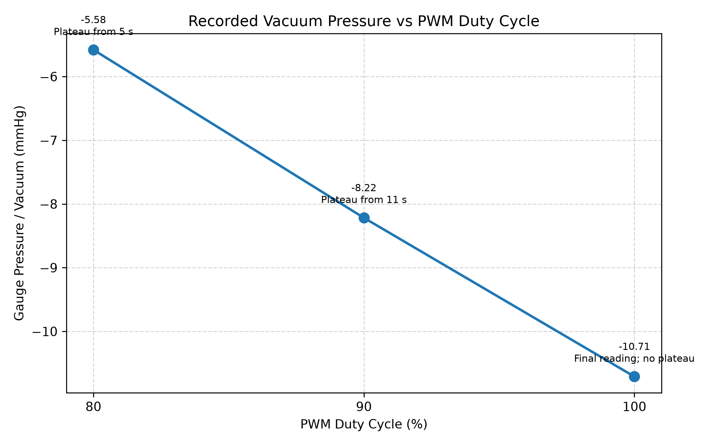

# Biomedical Vacuum Pump — Embedded Control System

An embedded systems and biomedical instrumentation project focused on developing a pressure-controlled vacuum pump prototype using a microcontroller, pressure sensing, motor control, and experimental characterization.

## Project Overview

This project explores the development of a biomimetic vacuum generation system inspired by the pressure-control requirements of a breast pump.

The prototype combines a DC vacuum pump, pressure sensor, motor driver, and Raspberry Pi Pico 2W running MicroPython. Experimental work has focused on pressure measurement, PWM-based motor control, and characterization of the relationship between motor duty cycle and generated vacuum.

The project also includes preliminary closed-loop control development, mechanical CAD modelling, and experimental data analysis.

> **Development status:** Research and prototype stage. The system has not been clinically validated and is not intended for medical use.

## Objectives

- Develop an embedded platform for vacuum generation and pressure monitoring.
- Interface a BMP280 pressure sensor with a Raspberry Pi Pico 2W.
- Implement PWM-based DC motor control.
- Characterize vacuum response at different motor duty cycles.
- Explore PI-based pressure regulation.
- Develop preliminary mechanical models for the pump and solenoid valve assemblies.
- Document experimental observations and identify areas for further development.

## System Architecture

The prototype follows a microcontroller-based feedback architecture.



The pressure sensor provides absolute pressure measurements. Gauge pressure is calculated relative to the atmospheric reference.

See [System Architecture](docs/architecture/system-architecture.md) for further details.

## Hardware

| Component | Description |
|---|---|
| Raspberry Pi Pico 2W | Main embedded controller |
| BMP280 | Pressure measurement over I2C |
| L298N | DC motor driver |
| KMDP-U1-24V | Vacuum pump |
| CKS5001/04 | Solenoid valve; integration under development |
| XL6009 | DC-DC converter used during development |

### Important hardware specifications

The KMDP-U1-24V pump documentation specifies a 24 V rating, 12 W power rating, nominal flow specification of 10 L/min, and maximum vacuum specification of approximately -70 kPa.

These are component specifications, not measured prototype performance.

Detailed information is available in [Hardware Design](docs/hardware/hardware-design.md).

## Firmware and Software

**Embedded platform:** Raspberry Pi Pico 2W
**Firmware language:** MicroPython
**Sensor interface:** I2C
**Motor control:** PWM and GPIO direction control
**Data analysis:** Python
**Mechanical modelling:** FreeCAD
**Electrical design:** KiCad

The firmware repository includes:

- BMP280 sensor drivers and pressure measurement modules.
- DC motor PWM and direction control.
- Preliminary PI controller implementation.
- Basic operating-mode and state-management modules.
- Hardware interface tests and experimental scripts.

The source tree contains multiple development iterations and sensor-driver interfaces. These are documented, but should not yet be considered a single fully integrated firmware release.

See [Firmware Documentation](docs/firmware/firmware-documentation.md).

## Experimental Work

Experimental characterization has been conducted to investigate the relationship between PWM duty cycle and generated vacuum.

The test routines include:

- PWM-based pump operation at multiple duty-cycle levels.
- Pressure measurement and serial data collection.
- Atmospheric reference checks.
- Analysis of transient response and observed pressure behaviour.
- Generation of plots and CSV summaries using Python.

### Preliminary observations

The intended application range was approximately -50 to -200 mmHg gauge pressure.

The documented prototype experiments produced approximately -3 to -11 mmHg gauge pressure under the tested conditions.

This indicates that substantial development is still required before the intended operating range can be achieved.

The experimental results should be interpreted in the context of the documented test conditions and prototype configuration.

### Experimental plots

**PWM response**



**Pressure response against PWM duty cycle**



Additional experimental plots and datasets are available in the [experiments/results](experiments/results/) directory.

## Mechanical Design

Preliminary FreeCAD models were developed for selected pump and valve components using physical measurements.

The repository includes:

- Motor sleeve model.
- Solenoid valve model.
- Motor and valve measurement documentation.
- Reference photographs and mechanical files.

These models are preliminary and have not been fully fabricated or validated.

## Repository Structure

```text
biomedical-vacuum-pump-embedded-control/
|
|-- docs/
|   |-- architecture/
|   |-- experiments/
|   |-- firmware/
|   |-- hardware/
|   |-- project-status.md
|
|-- electronics/
|   |-- kicad/
|
|-- experiments/
|   |-- analysis/
|   |-- raw_data/
|   |-- results/
|
|-- firmware/
|   |-- control/
|   |-- drivers/
|   |-- tests/
|
|-- mechanical/
|   |-- cad/
|   |-- measurements/
|
|-- media/
|   |-- diagrams/
|   |-- plots/
|   |-- prototype/
|
|-- research/
|   |-- literature/
|   |-- notes/
|
|-- README.md
|-- .gitignore
```

## Documentation

| Document | Description |
|---|---|
| [System Architecture](docs/architecture/system-architecture.md) | System-level design and interfaces |
| [Hardware Design](docs/hardware/hardware-design.md) | Hardware components and preliminary design |
| [Firmware Documentation](docs/firmware/firmware-documentation.md) | Firmware modules and implementation |
| [Experimental Methodology](docs/experiments/experimental-methodology.md) | Experimental procedures and conditions |
| [Results and Analysis](docs/experiments/results-and-analysis.md) | Experimental data and observations |
| [Project Status](docs/project-status.md) | Completed work and remaining tasks |

## Current Development Status

| Subsystem | Status |
|---|---|
| Pump and sensor experimentation | Preliminary testing completed |
| PWM motor control | Implemented and tested experimentally |
| Pressure measurement | Implemented; further calibration and integration required |
| Experimental data analysis | Completed for documented datasets |
| Mechanical CAD | Preliminary models developed |
| PI pressure control | Preliminary implementation; tuning and validation pending |
| Solenoid valve integration | Pending |
| Fully integrated system | In progress |

## Future Work

- Reconcile and consolidate the BMP280 driver interfaces.
- Establish and verify the final hardware wiring and power arrangement.
- Improve the pneumatic assembly and investigate vacuum leakage.
- Integrate and validate solenoid valve operation.
- Tune and test the PI pressure controller.
- Perform repeatable closed-loop pressure-control experiments.
- Evaluate system response, stability, and achievable vacuum range.
- Fabricate and validate the preliminary mechanical designs.

## Disclaimer

This repository documents an academic engineering prototype and experimental development work. It is not a certified medical device, has not undergone clinical validation, and must not be used for medical applications.

---

**Project focus:** Embedded Systems | Biomedical Instrumentation | Pressure Control | Microcontrollers | Experimental Characterization
