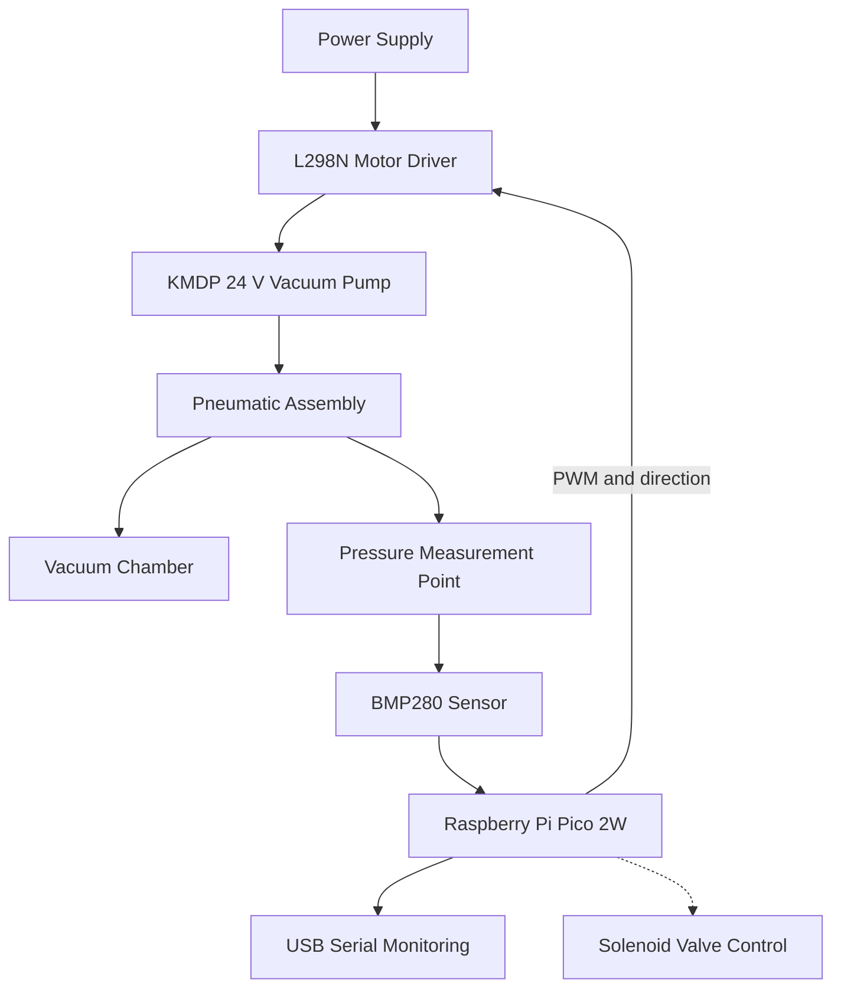

# System Architecture

## 1. Project Overview

This project involved developing an embedded, pressure-monitored vacuum pump prototype using components adapted from a commercially available breast-pump assembly.

The system combines a DC vacuum pump, pressure sensing, microcontroller-based motor actuation and preliminary feedback-control software.

The work focused on pressure measurement, PWM-based pump control, experimental characterisation and the development of a pressure-regulation system.

This repository documents an engineering research and development prototype. It is not a clinically validated or certified medical device.

## 2. System Block Diagram

The valve-control path represents the intended architecture and
was not validated as a complete integrated subsystem.
3. Embedded Controller
The Raspberry Pi Pico 2W was used as the microcontroller in the
later prototype development.
The embedded platform was intended to:
- Acquire pressure measurements through I2C.
- Establish an atmospheric pressure reference.
- Calculate gauge pressure.
- Generate PWM signals for motor control.
- Monitor pressure response.
- Support future closed-loop pressure regulation.
Pin Configuration
Function
Pico 2W assignment
I2C controller
I2C(0)
SDA
GP0
SCL
GP1
I2C frequency
400 kHz
Motor PWM
GP2
Motor direction 1
GP3
Motor direction 2
GP4
Serial monitoring
USB
These assignments correspond to the inspected firmware source.
Earlier wiring notes contain different pin assignments.
4. Pneumatic Architecture
The prototype used a KMDP-U1-24V vacuum pump and components
adapted from a reusable breast-pump assembly.
The pneumatic development involved the pump, tubing, chamber
and flange assembly, pressure measurement connection, and a
CKS5001/04 solenoid valve intended for pneumatic switching.
The precise final routing and valve placement should be verified
against the physical prototype before reproducing the system.
5. Pressure Measurement
The BMP280 measures absolute pressure.
Gauge pressure is calculated relative to atmospheric pressure:
\[P_{gauge}=P_{measured}-P_{atmosphere}\]
Negative gauge pressure indicates pressure below atmospheric
pressure.
Atmospheric calibration was included in the experimental
firmware approach.
6. Pump Actuation
The KMDP pump was controlled using an L298N motor-driver module.
The inspected motor firmware uses GP2 for PWM and GP3/GP4 for
direction control. Its configured PWM frequency is 1 kHz.
PWM duty cycle was varied to investigate the relationship between
motor command and the resulting vacuum pressure.
7. Solenoid Valve
A CKS5001/04, 5 V DC, two-wire solenoid valve was identified
and measured for integration.
A valve-control software module exists, but complete electrical
and pneumatic integration was not validated.
8. Development Evolution
The project progressed through:
1. Initial sensor and motor experiments.
2. Pressure measurement and PWM characterisation.
3. Transition to the Raspberry Pi Pico 2W.
4. Development of modular MicroPython code.
5. Preliminary PI feedback-control implementation.
6. Experimental data analysis and documentation.
The KiCad schematic in the repository is an earlier ESP32-based
design reference, not the final Pico 2W wiring schematic.
9. Implementation Status
Subsystem
Status
KMDP vacuum pump
Used in prototype experiments
BMP280 sensing
Used in pressure measurement
Pico 2W controller
Used in later development
L298N motor actuation
Used for pump control
PWM characterisation
Experimentally performed
PI controller
Implemented in source; not validated
Solenoid valve
Integration incomplete
Operating modes
Preliminary software
State machine
Basic software structure
Complete closed-loop system
Not validated
10. Limitations
The intended pressure range was approximately -50 to -200 mmHg.
Documented experimental measurements were approximately -3 to
-11 mmHg.
The prototype was an engineering development platform, not a
clinically validated medical device.
