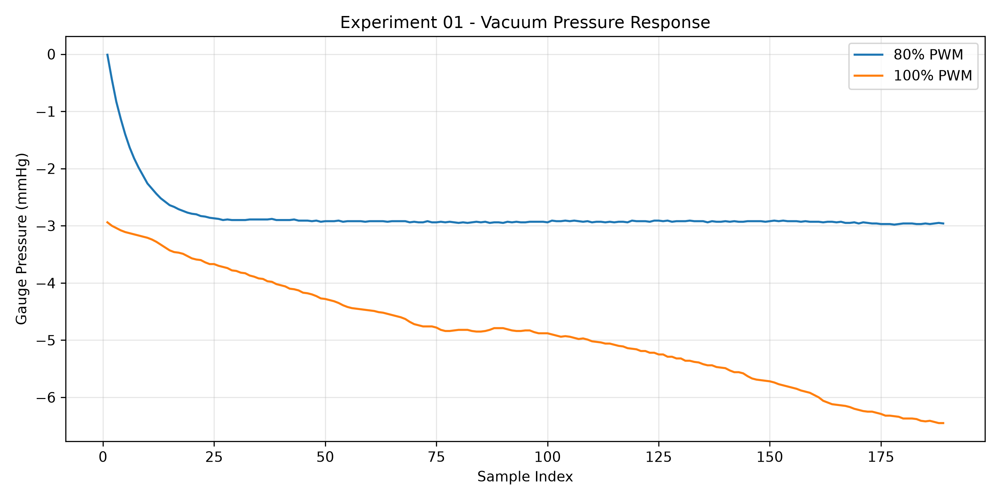
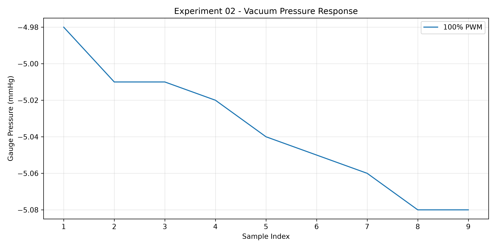
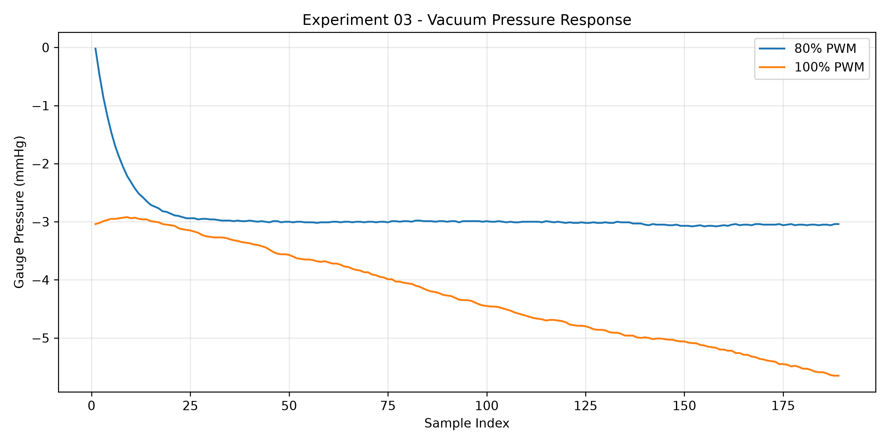
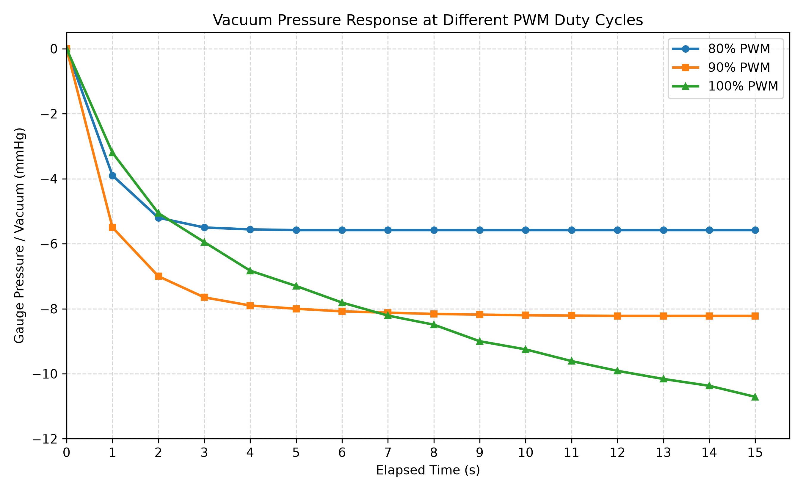
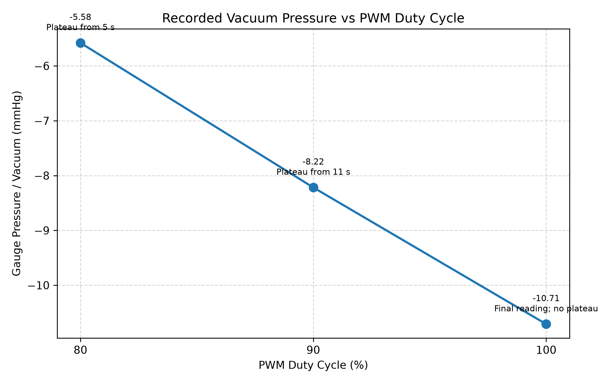

# Experimental Results and Analysis

## 1. Overview

The prototype was evaluated through three archived experiments and a separate final lab-session dataset.

Pressure values are reported as gauge pressure in mmHg. Negative values indicate pressure below the atmospheric reference. A more negative value represents a greater vacuum magnitude.

## 2. Archived experiment results

### 2.1 Summary

| Experiment | PWM Duty Cycle | Samples | Mean Pressure (mmHg) | Most Negative Pressure (mmHg) |
|---|---:|---:|---:|---:|
| Experiment 01 | 80% | 189 | -2.826 | -2.98 |
| Experiment 01 | 100% | 189 | -4.876 | -6.45 |
| Experiment 02 | 100% | 9 | -5.037 | -5.08 |
| Experiment 03 | 80% | 189 | -2.912 | -3.08 |
| Experiment 03 | 100% | 189 | -4.278 | -5.65 |

### 2.2 Experiment 01

At 80% PWM, the recalculated mean gauge pressure was approximately -2.826 mmHg, with a most negative recorded value of -2.98 mmHg.

At 100% PWM, the mean was approximately -4.876 mmHg, and the most negative recorded value was -6.45 mmHg.

The recalculated means agree with the summary values in the original log to within approximately 0.004 mmHg.

### 2.3 Experiment 02

The nine recorded measurements at 100% PWM produced:

- Mean gauge pressure: -5.037 mmHg
- Most negative recorded pressure: -5.08 mmHg
- Final recorded pressure: -5.08 mmHg

The limited number of measurements does not support a complete transient-response or repeatability assessment.

### 2.4 Experiment 03

At 80% PWM, the recalculated mean gauge pressure was approximately -2.912 mmHg, with a most negative value of -3.08 mmHg.

At 100% PWM, the recalculated mean was approximately -4.278 mmHg, with a most negative value of -5.65 mmHg.

The recalculated means agree with the original reported values to within approximately 0.002 mmHg.

The 100% PWM segment began after the 80% PWM segment, with no documented atmospheric reset between them. This initial-condition difference should be considered when comparing the results.

## 3. Final lab-session results

The supplementary final-session dataset contained 16 readings at each of three PWM settings.

| PWM Duty Cycle | Mean Pressure (mmHg) | Final Pressure (mmHg) | Plateau Assessment |
|---|---:|---:|---|
| 80% | -5.096 | -5.58 | Plateau detected |
| 90% | -7.368 | -8.22 | Plateau detected |
| 100% | -7.616 | -10.71 | No plateau detected |

The 80% and 90% settings showed relatively stable terminal readings under the selected numerical plateau criterion.

At 100% PWM, pressure continued becoming more negative through the end of the recorded 15-second interval. The final value is therefore an endpoint measurement, not a steady-state value.

## 4. Key observations

1. The archived experiments showed greater vacuum magnitude at 100% PWM than at 80% PWM.
2. The independently recalculated means closely matched the summary statistics in Experiments 01 and 03.
3. The final lab-session dataset showed a stronger vacuum response at higher PWM settings over the recorded interval.
4. The 100% final-session trace had not reached the selected plateau criterion by the end of the observation period.
5. The archived and final-session datasets must remain separate because their sampling intervals, source records, and experimental conditions differ.

## 5. Limitations

The measured vacuum levels remained far below the intended operating range of approximately -50 to -200 mmHg.

The results represent preliminary prototype testing. They do not establish performance across the intended operating range, repeatability across independently reset trials, closed-loop pressure regulation, or medical safety.

Further work would require improved vacuum generation, controlled initial conditions, repeated trials, calibrated instrumentation, and completion and validation of the pressure-control implementation.

## 6. Generated data and analysis files

### Raw and supplementary data

- `experiments/raw_data/EXPERIMENT 01.txt`
- `experiments/raw_data/EXPERIMENT-02.txt`
- `experiments/raw_data/EXPERIMENT-03.txt`
- `experiments/raw_data/supplementary/final_lab_session_pwm.csv`

### Processed data

- `experiments/results/archived_measurements.csv`
- `experiments/results/archived_experiment_summary.csv`
- `experiments/results/final_session_summary.csv`

### Analysis scripts

- `experiments/analysis/analyze_archived_experiments.py`
- `experiments/analysis/analyze_experiments.py`
- `experiments/analysis/plot_archived_responses.py`
- `experiments/analysis/plot_pwm_response.py`
- `experiments/analysis/plot_steady_state.py`
